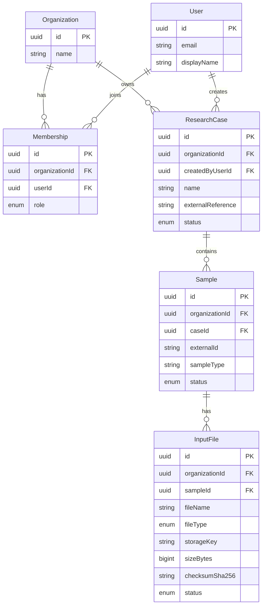

# OncoTrace — Domain Model

## 1. Purpose

This document describes the main business entities, relationships, and domain invariants.

## 2. Core Entities

### Organization

Represents a tenant using OncoTrace.

Important fields:

- id
- name
- createdAt

An organization owns research cases and has users associated through memberships.

### User

Represents an application user.

Important fields:

- id
- email
- displayName
- createdAt

A user can belong to multiple organizations through memberships.

### Membership

Connects a user to an organization.

Important fields:

- userId
- organizationId
- role
- createdAt

Supported roles:

- OWNER
- ADMIN
- ANALYST
- VIEWER

The role will determine permitted operations as authorization policies are implemented.

### ResearchCase

Represents a research investigation.

Important fields:

- id
- organizationId
- name
- description
- externalReference
- status
- createdByUserId
- createdAt
- updatedAt

A case belongs to exactly one organization and has one creator.

### Sample

Represents a biological sample associated with a research case.

Important fields:

- id
- organizationId
- caseId
- externalId
- sampleType
- status
- createdAt
- updatedAt

A sample belongs to one research case.

### InputFile

Represents metadata about a sequencing or analysis input file.

Important fields:

- id
- organizationId
- sampleId
- fileName
- fileType
- storageKey
- sizeBytes
- checksumSha256
- status
- createdAt
- updatedAt

File contents are stored outside PostgreSQL in planned private object storage.

## 3. Entity Relationships

## 4. Domain Invariants

### Organization

- A user can belong to multiple organizations.
- A membership is unique per organization and user.

### Research Case

- Every case belongs to one organization.
- Every case has a creator.
- External references are unique within an organization when provided.

### Sample

- Every sample belongs to exactly one case.
- Every sample belongs to the same organization as its case.
- External sample IDs are unique within a case.
- A sample cannot be deleted while dependent input files exist under the current Restrict relationship.

### Input File

- Every input file belongs to exactly one sample.
- Every input file belongs to the same organization as its sample.
- Storage keys are unique.
- File status represents its lifecycle.
- File contents are not stored directly in PostgreSQL.

## 5. Status Lifecycles

### Research Case

- ACTIVE
- ARCHIVED

### Sample

- REGISTERED
- READY
- ARCHIVED

### Input File

- REGISTERED
- UPLOADING
- UPLOADED
- VALIDATING
- VALIDATED
- FAILED

These enums describe available states. Valid transition rules must be implemented in the application layer.

## 6. Planned Domain Extensions

Future entities may include:

- AnalysisJob
- Pipeline
- PipelineVersion
- ReferenceGenome
- Variant
- VariantAnnotation
- EvidenceSource
- EvidenceRecord
- ResearchReport
- AuditEvent

These entities should be added when their workflows and requirements are defined.
