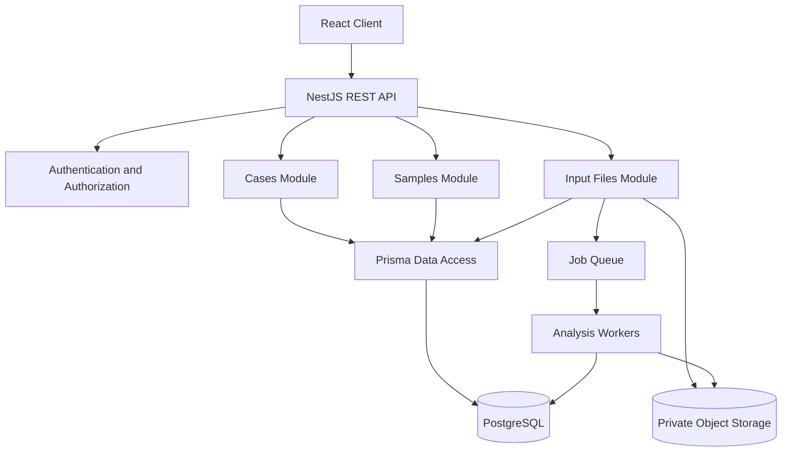

# OncoTrace — Architecture Overview

## 1. Architectural Goals

The architecture is designed to support a modular, secure, and extensible genomics research platform.

Primary goals:

- Clear separation of domain responsibilities.
- Organization-level tenant isolation.
- Predictable REST API contracts.
- Reliable relational data management.
- Asynchronous processing for long-running genomic workflows.
- Reproducible analysis and evidence provenance.
- Automated testing and maintainable code.

## 2. Technology Stack

| Layer          | Technology                          | Purpose                      |
| -------------- | ----------------------------------- | ---------------------------- |
| Backend        | NestJS                              | Application framework        |
| Language       | TypeScript                          | Type safety                  |
| Runtime        | Node.js                             | Server runtime               |
| Database       | PostgreSQL                          | Relational persistence       |
| ORM            | Prisma 7                            | Data access and migrations   |
| API            | REST                                | Resource-oriented interface  |
| Validation     | class-validator / class-transformer | Request validation           |
| Testing        | Vitest                              | Unit and E2E testing         |
| Frontend       | React + TypeScript                  | Planned user interface       |
| Object storage | To be selected                      | Planned genomic file storage |
| Queue          | To be selected                      | Planned asynchronous jobs    |

## 3. Architectural Style

The backend uses a modular monolithic architecture.

Each business domain is organized into a NestJS module with its own controller, service, and DTOs.

Initial modules:

- Auth
- Prisma
- Cases
- Samples
- Input Files

Planned modules:

- Analysis Jobs
- Variants
- Annotations
- Evidence
- Reports
- Audit

A modular monolith is preferred initially because it provides clear domain boundaries without the operational complexity of distributed microservices.

Modules should communicate through explicit service interfaces rather than directly accessing each other's internal implementation.

## 4. High-Level Architecture

The diagram includes planned components. The queue, workers, object storage, and React client are not all implemented at the current stage.

## 5. Backend Module Responsibilities

### Auth Module

Responsibilities:

- Identify the authenticated user.
- Resolve organization membership.
- Enforce authorization policies.
- Provide organization context to application services.

The current development authentication guard is for local development and testing only.

### Cases Module

Responsibilities:

- Create research cases.
- List cases.
- Retrieve case details.
- Enforce organization ownership.

### Samples Module

Responsibilities:

- Register samples within research cases.
- List samples.
- Retrieve sample details.
- Enforce case and organization ownership.

### Input Files Module

Responsibilities:

- Register file metadata.
- Manage file lifecycle state.
- Coordinate secure file storage.
- Initiate validation workflows.

### Prisma Module

Responsibilities:

- Provide database access.
- Manage Prisma client lifecycle.
- Centralize database connectivity.

## 6. Data Ownership and Tenant Isolation

Organization-owned data is associated with an organization.

The application derives organization context from authenticated membership rather than trusting organization IDs supplied by clients.

Database relationships also enforce consistency:

- Sample references ResearchCase through organizationId and caseId.
- InputFile references Sample through organizationId and sampleId.

Application authorization and database integrity are complementary controls.

## 7. API Conventions

- Prefix: `/api/v1`
- JSON request and response bodies.
- Resource-oriented REST endpoints.
- DTO-based validation.
- Consistent HTTP status codes.
- Cursor-based pagination for collections.
- Organization context derived from authentication.
- OpenAPI documentation planned.

## 8. Error Handling

Use consistent HTTP semantics:

- 400: Invalid request.
- 401: Authentication required.
- 403: Authenticated but insufficient permission.
- 404: Resource does not exist or is not accessible within the organization.
- 409: Resource conflicts with an existing constraint.
- 500: Unexpected server error.

Do not expose raw database errors, stack traces, secrets, or internal storage paths to clients.

## 9. Long-Running Workflows

Genomic processing must not run inside ordinary HTTP request lifecycles.

The planned workflow is:

1. API validates a job request.
2. Job metadata is persisted.
3. Work is published to a queue.
4. A worker claims the job.
5. Processing takes place outside the API process.
6. Results and job status are persisted.
7. The client retrieves status and results.

Job execution must eventually support retry policies, idempotency, and failure recovery.

## 10. Future Architecture Evolution

The modular monolith may evolve into independently deployed services only when justified by:

- Independent scaling requirements.
- Team ownership boundaries.
- Deployment independence.
- Resource isolation.
- Operational requirements.

Microservices are not an initial requirement.
